<picture>
  <source media="(prefers-color-scheme: dark)" srcset="assets/generated/hero-dark.svg" />
  
</picture>

  <a href="#about-me">About</a> &nbsp;·&nbsp;
  <a href="#tech-stack">Tech stack</a> &nbsp;·&nbsp;
  <a href="#portfolio-projects">Projects</a> &nbsp;·&nbsp;
  <a href="#activity">Activity</a> &nbsp;·&nbsp;
  <a href="#contact">Contact</a>

## About me

I design and build software end to end, from the first wireframe to the deployed product. With a double major in Interactive Development and UX Design, I care as much about *why* an interface works as about the code behind it.

This year I shipped three products: a cross-platform learning management system with a team of four, a gesture-only revision app for iOS and Android, and an AI workspace that assembles its interface around the task in front of you.

**Career focus**

- **Full-stack product development:** typed React frontends with .NET, Firebase and Supabase backends
- **Design systems and UX:** research, wireframes and component libraries, with accessibility built in (contrast checks, reduced motion, alternative inputs)
- **AI-native interfaces:** structured model output, schema validation and safe fallbacks, so the AI never has the last word on data
- **Cross-platform apps:** Electron on the desktop, React Native and Expo on mobile
- **Engineering quality:** automated testing, clear Git history and CI

## Tech stack

<table>
  <tr>
    <td><b>Languages</b></td>
    <td><picture><source media="(prefers-color-scheme: dark)" srcset="assets/stack/languages-dark.svg" /></picture></td>
  </tr>
  <tr>
    <td><b>Frontend</b></td>
    <td><picture><source media="(prefers-color-scheme: dark)" srcset="assets/stack/frontend-dark.svg" /></picture></td>
  </tr>
  <tr>
    <td><b>Desktop &amp; mobile</b></td>
    <td><picture><source media="(prefers-color-scheme: dark)" srcset="assets/stack/apps-dark.svg" /></picture></td>
  </tr>
  <tr>
    <td><b>Backend &amp; data</b></td>
    <td><picture><source media="(prefers-color-scheme: dark)" srcset="assets/stack/backend-dark.svg" /></picture></td>
  </tr>
  <tr>
    <td><b>AI</b></td>
    <td><picture><source media="(prefers-color-scheme: dark)" srcset="assets/stack/ai-dark.svg" /></picture></td>
  </tr>
  <tr>
    <td><b>DevOps &amp; testing</b></td>
    <td><picture><source media="(prefers-color-scheme: dark)" srcset="assets/stack/devops-dark.svg" /></picture></td>
  </tr>
  <tr>
    <td><b>Design</b></td>
    <td><picture><source media="(prefers-color-scheme: dark)" srcset="assets/stack/design-dark.svg" /></picture></td>
  </tr>
</table>

## Portfolio projects

My three DV300 major projects from 2026. Each repository has full documentation: setup, architecture, testing and a demo.

<table>
<tr>
<td>

<h3></h3>

<a href="https://github.com/wrapperik/koru">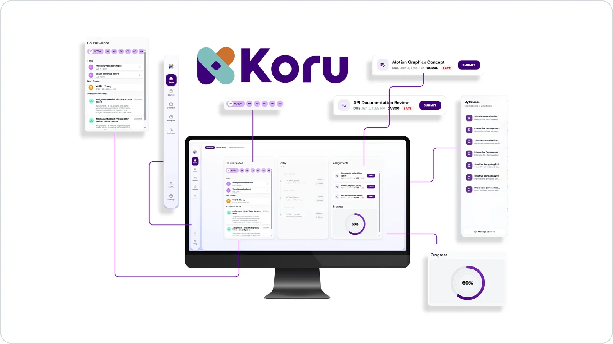</a>

**A cross-platform learning management system for students, lecturers and administrators.**

Koru replaces a college's patchwork of tools with one POPIA-compliant platform for courses, assignments, grading, attendance, timetables and analytics, each tailored to the role that signs in.

**My focus:** the frontend and its design system. I built the Material 3–based component library, the split-screen sign-in flow, the dashboards and analytics views, grades and attendance, avatars throughout, and the AI assistant, and I fixed the timetabling flow.

      

**[Repository →](https://github.com/wrapperik/koru)**

<picture>
  <source media="(prefers-color-scheme: dark)" srcset="assets/generated/koru-dark.svg" />
  
</picture>

<b>More screens</b>

 
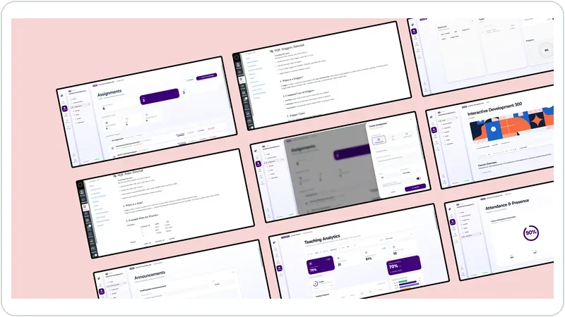
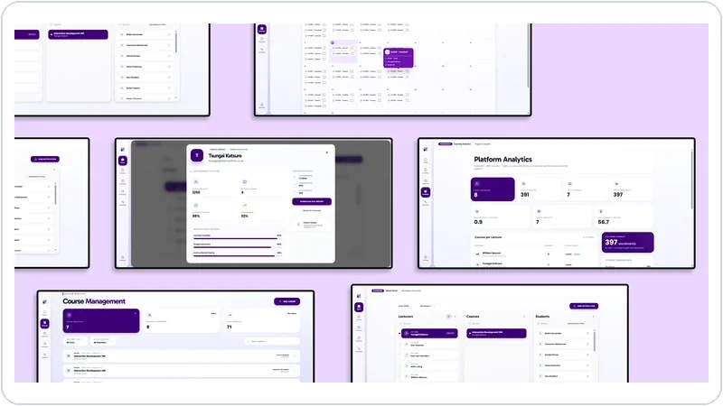

</td>
</tr>
</table>

<table>
<tr>
<td>

<h3></h3>

<a href="https://github.com/wrapperik/cardinal">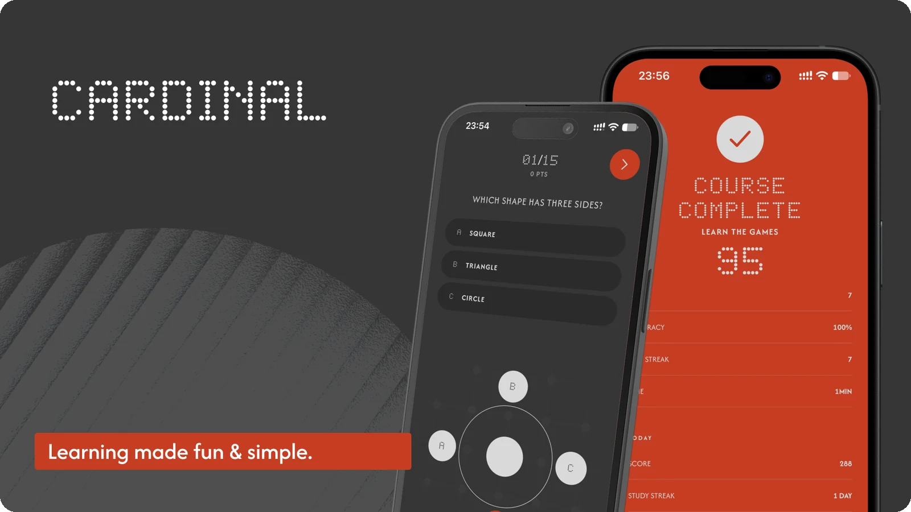</a>

**A revision app where the direction you swipe is the answer.**

Each question's answers sit at the four compass points around it, and you flick towards the one you believe is right. The original design has no buttons at all; version 2.0 adds a tap-based Traditional mode so the app works for everyone. Students upload their own notes, and Gemini turns them into decks through a Cloud Function, so the API key never reaches the device.

- Gesture physics on the UI thread with Reanimated and Gesture Handler
- Local-first data: cached reads and an offline outbox that syncs to Firestore
- Four game templates, streaks, scoring and an admin dashboard

     

**[Repository →](https://github.com/wrapperik/cardinal)** &nbsp;·&nbsp; **[Demo video →](https://youtu.be/275TFCt4XFM)**

<picture>
  <source media="(prefers-color-scheme: dark)" srcset="assets/generated/cardinal-dark.svg" />
  
</picture>

<b>More screens</b>

 
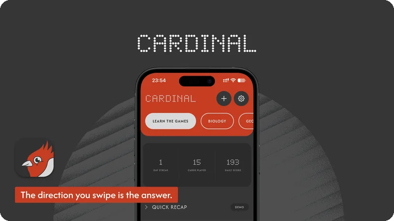
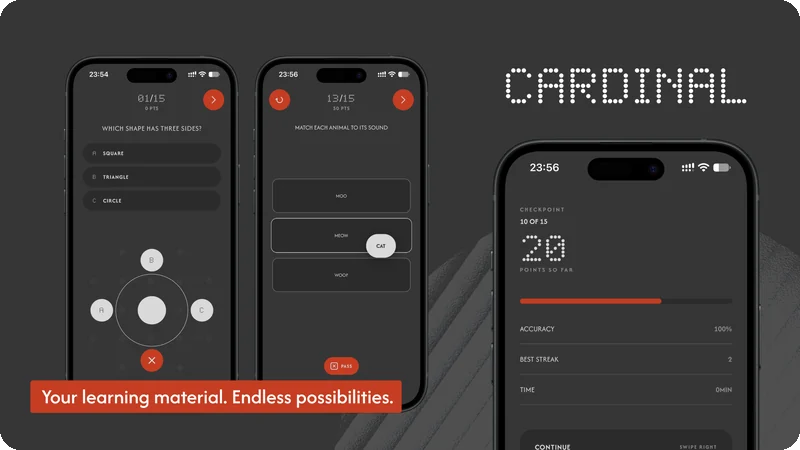

</td>
</tr>
</table>

<table>
<tr>
<td>

<h3></h3>

<a href="https://droplet-tan.vercel.app">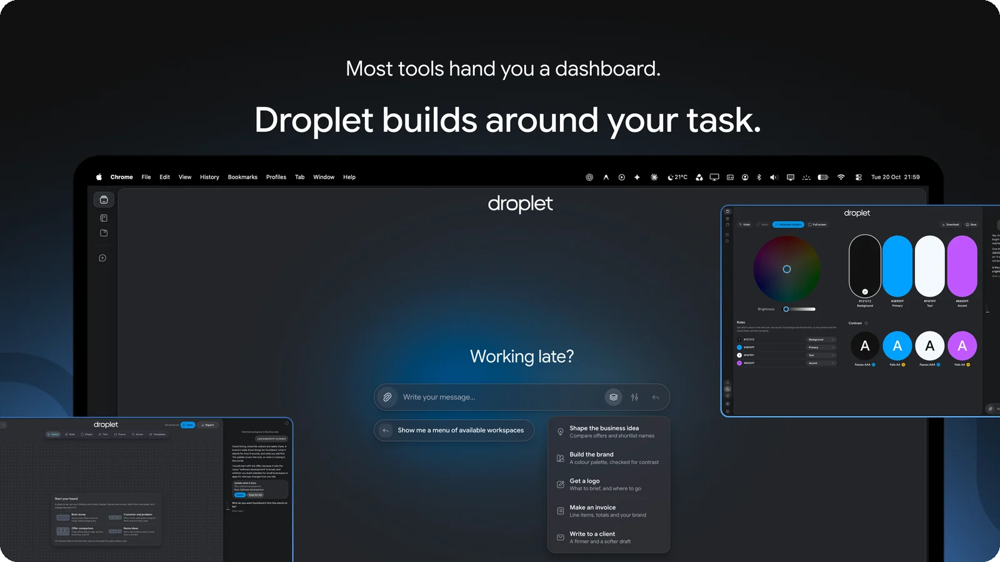</a>

**An AI workspace for small business owners that builds the interface around the task.**

Founders say what they need, such as an invoice, a brand palette or a business plan, and Droplet opens the right workspace from a library of tested components. The model decides what to show; the app's own code draws it, checks it and does the sums, so totals and VAT are never left to the AI.

- Every AI turn is validated against a Zod schema, retried once with the reasons, then falls back safely
- Every change is listed with Undo, and nothing is saved without the founder's say-so
- Web research, attachments, chat memory and branded PDF exports

      

**[Live app →](https://droplet-tan.vercel.app)** &nbsp;·&nbsp; **[Repository →](https://github.com/wrapperik/droplet)** &nbsp;·&nbsp; **[Walkthrough →](https://youtu.be/oBLeca-GEqo)** &nbsp;·&nbsp; **[Promo →](https://youtu.be/WLlGiDC9sms)**

<picture>
  <source media="(prefers-color-scheme: dark)" srcset="assets/generated/droplet-dark.svg" />
  
</picture>

<b>More screens</b>

 
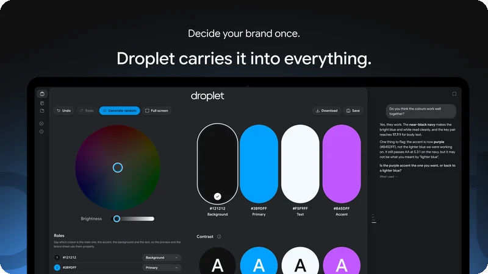
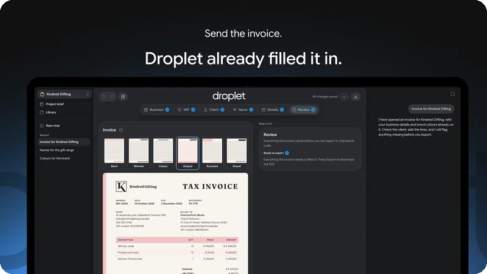

</td>
</tr>
</table>

## Activity

<picture>
  <source media="(prefers-color-scheme: dark)" srcset="assets/generated/stats-dark.svg" />
  
</picture>

<b>Earlier work (DV200, 2025)</b>

 

| Project | What it is | Repository |
|---|---|---|
| **Gamestat** | Compare games side by side | [formative-one-gamestat](https://github.com/wrapperik/formative-one-gamestat) |
| **Billionaires** | An e-commerce store for the very rich (team project) | [Code_Blooded_DV200_S1SA2_Ecommerce_App](https://github.com/victordupreez0/Code_Blooded_DV200_S1SA2_Ecommerce_App) |
| **Unmute** | An online community for men's mental health | [unMute_RikusPretorius_241044](https://github.com/wrapperik/unMute_RikusPretorius_241044) |

## Contact

  
  

The hero, project and stats cards on this page are SVGs generated by <a href="scripts/generate.mjs">a small Node script</a> and refreshed daily by <a href=".github/workflows/refresh-cards.yml">a GitHub Action</a>. They follow your light or dark theme and respect reduced-motion settings. Stack icons from <a href="https://skillicons.dev">Skill Icons</a> and <a href="https://simpleicons.org">Simple Icons</a>; type set in <a href="https://github.com/JulietaUla/Montserrat">Montserrat</a> (SIL Open Font License).
